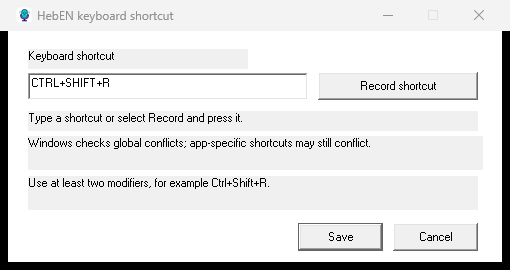

[English](README.md) · [עברית](README.he.md)

<p align="center"></p>

# HebEN Dictation

**הכתבה מקומית בעברית ובאנגלית ל־Windows.** בוחרים שדה טקסט, לוחצים על קיצור מקשים ומדברים. HebEN פועל במגש המערכת ומקליד טקסט Unicode ביישום הפעיל.

**גרסת v1.0.0 MVP:** תהליך ההכתבה המרכזי זמין לשימוש. דיוק התמלול, התאימות לעורכים, צריכת המשאבים וההכתבה ההדרגתית ממשיכים להשתפר. מומלץ לבדוק תוצאות לפני שימוש בטקסט חשוב.

## מה כלול

- זיהוי דיבור מקומי המבוסס על Whisper וזיהוי דיבור באמצעות Silero; ללא שירות תמלול בענן בזמן הריצה.
- עברית, אנגלית ודיבור משולב, עם בחירת שפה אוטומטית או ידנית.
- קיצור מקשים גלובלי שניתן לשינוי, פקדים במגש המערכת ונקודה ליד הסמן כאשר מיקומו המדויק זמין.
- הקלדת Unicode ללא שימוש בלוח ההעתקה כברירת מחדל.
- יישום C++‎/Win32 ללא צורך ב־Python בזמן הריצה.
- אפשרות ניסיונית להצגת טקסט בהדרגה בזמן דיבור; היא **כבויה כברירת מחדל** בחבילת ההפצה.



## התקנה ושימוש

1. הורידו את קובץ Windows CPU מדף [הגרסאות](https://github.com/NRG-Wardog/STT/releases), חלצו אותו לתיקייה בעלת הרשאת כתיבה והפעילו את `HebENDictation.exe`. יש להשאיר את תיקיית `models` ליד קובץ ההפעלה.
2. אפשרו גישה למיקרופון בהגדרות Windows ובחרו את התקן הקלט הרצוי. לאחר ההתקנה אין צורך באינטרנט לצורך הכתבה.
3. לחצו בשדה טקסט רגיל ולא רגיש. לחצו ושחררו **Ctrl+Shift+R** ודברו. לחיצה נוספת או כחמש שניות ללא דיבור יעצרו את ההאזנה. השאירו את השדה בפוקוס עד להקלדת הטקסט.
4. סמל המיקרופון נמצא במגש המערכת, לעיתים תחת הסמלים הנסתרים. נקודה תופיע ליד הסמן כאשר היישום חושף את מיקומו המדויק.

החבילה הניידת אינה מוסיפה את עצמה אוטומטית להפעלה עם Windows. אפשר להוסיף קיצור לקובץ ההפעלה לתיקיית Startup של Windows ולהסירו מאוחר יותר.

### קיצור מקשים ושפה

לחצו לחיצה ימנית על הסמל ובחרו **Keyboard shortcut…**. אפשר להקליד צירוף או לבחור **Record shortcut**, ואז **Save**. צירופים נפוצים כגון Ctrl+C נחסמים ונבדקת התנגשות של קיצור גלובלי; לא ניתן לזהות כך את כל הקיצורים הפנימיים של כל יישום.

בתפריט **Language** ניתן לבחור עברית, אנגלית או זיהוי אוטומטי. משפטים קצרים בעברית או מעבר בין שפות באותו משפט עלולים להיות מזוהים לא נכון.

### טקסט במהלך הדיבור

כברירת מחדל הטקסט מוכנס לאחר משפט או הפסקה. לניסוי הכתבה הדרגתית, הגדירו `streaming_prototype=1` בקובץ `config.ini` ובחרו **Reload settings**. התכונה ניסיונית: השערה מאוחרת עשויה לסתור מילים שכבר הוקלדו, ואין הבטחה לזיהוי מילה בתוך שנייה.

### מסופים ושדות רגישים

ההגדרה `trusted_terminal_input=1` מאפשרת במפורש קלט בחלק מהמסופים גם כשלא ניתן לזהות את סוג ההנחיה. השתמשו בה רק בהנחיות שאינן רגישות: לא כל בקשת סיסמה במסוף ניתנת לזיהוי. שדות שמזוהים כסיסמה ויישומים בהרשאה גבוהה יותר נחסמים. היישום אינו שולח Enter או מגיש הודעות אוטומטית.

הדבקה באמצעות לוח ההעתקה היא אפשרות ניסיונית שאינה ברירת המחדל; בבדיקות קודמות שחזור הלוח נכשל, ולכן אין להסתמך עליה.

## דרישות ותאימות

נדרשים Windows 10/11 ‏64-bit, מעבד x64 עם AVX2, ‏FMA, ‏F16C ו־BMI2, ומיקרופון. חבילת CPU משתמשת במודל Whisper multilingual small Q5_1 וב־Silero VAD. בניית CUDA דורשת כרטיס NVIDIA, מנהל התקן וספריות מתאימות; המודל העברי ההיברידי אינו כלול בחבילת CPU. גודל המודל אינו זהה לצריכת הזיכרון בזמן הסקה.

הכנסת טקסט נצפתה בבדיקות מוגבלות ב־Notepad, ‏Chrome/ChatGPT, ‏VS Code ומסוף Codex, בגרסאות ניסיון שונות. זו אינה הוכחה לתאימות בכל שדה או יישום. שינוי פוקוס, נגישות, הרשאות והתנהגות מסוף עשויים למנוע הכנסה.

## מדידות ודוגמאות

| מדידה היסטורית | תוצאה | תנאים |
|---|---:|---|
| זיכרון פרטי / working set בסרק | 4.00 / 13.56 MiB חציון | מועמד CUDA ‏`c5ff8e…`, ‏59 דגימות במרווח שנייה |
| מיקרופון פעיל, ללא דיבור מזוהה | 1,118 / 158.9 MiB חציון | אותו מועמד CUDA; זיכרון פרטי / working set |
| טקסט חלקי ראשון | 3.28 שניות חציון | fixture אחר `ed7e43…`; אותה הקלטה חמש פעמים |
| WER עברית / אנגלית / משולב | 20.0% / 7.2% / 28.1% | fixture היברידי אחר `517ca1…`; ‏30 קטעים לכל קבוצה, ייחוס לא מאומת והמשולבים חוברו מלאכותית |

אלה **אינן מדידות של חבילת CPU** ואין לראות בשורות מדידה של אותה תצורה. פרטי חומרה, שיטה, CER ומגבלות נמצאים ב־[Benchmarks](docs/BENCHMARKS.md). זמני תגובה ומשאבים של חבילת CPU טרם נמדדו.

## בנייה ובדיקות

יש להתקין Visual Studio 2022 עם **Desktop development with C++**, ‏CMake ו־Git. מתוך עותק חדש של המאגר:

```powershell
cmake -S . -B build -A x64 -DGGML_CUDA=OFF
cmake --build build --config Release --parallel 4 --target HebENDictation HebENDetectorTest HebENUnicodeInputTest HebENClipboardMockTest HebENStablePrefixTest HebENHotkeyPolicyTest HebENHotkeyRegistryTest
ctest --test-dir build -C Release --output-on-failure
```

התלויות מורדות כארכיונים עם hash קבוע. פרטי המודלים, בדיקות fixture ובניית CUDA נמצאים ב־[Development](docs/DEVELOPMENT.md). הפקודה `build.ps1 -Model small` יוצרת תיקיית `dist` מקומית ועשויה להחליף את קובץ ההפעלה בה.

## מגבלות ורישיונות

איכות הזיהוי תלויה במודל, בקול ובמיקרופון. הנקודה אינה זמינה בכל יישום; שינוי פוקוס עלול למנוע הכנסת טקסט. חלק מהעורכים והמסופים אינם נתמכים בכל מצב, והכתבה הדרגתית עדיין ניסיונית. היישום והמודלים עשויים לצרוך זיכרון משמעותי בעת פעילות.

קוד HebEN זמין ברישיון [MIT](LICENSE). רישיונות Whisper, ‏whisper.cpp, ‏miniaudio, ‏Silero, מודלי ivrit.ai ורכיבי NVIDIA מפורטים ב־[Licensing](docs/LICENSING.md); פרטי הגרסה נמצאים ב־[release notes](docs/RELEASE-NOTES.md).
