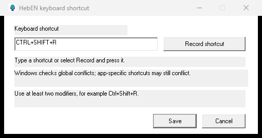

[English](README.md) · [עברית](README.he.md)

<p align="center"></p>
<h1 align="center">HebEN Dictation</h1>
<p align="center"><strong>Offline Hebrew and English voice typing for Windows.</strong><br>Press a global shortcut, speak, and insert recognized text into the focused editor.</p>
<p align="center"><a href="https://github.com/NRG-Wardog/STT/releases/tag/v1.0.0">Download v1.0.0</a> · <a href="docs/DEVELOPMENT.md">Developer guide</a> · <a href="docs/BENCHMARKS.md">Benchmarks</a></p>

**Status: v1.0.0 MVP.** The core dictation workflow is available for use. Recognition quality, editor compatibility and optional low-latency streaming continue to improve. The released CPU build is **not the same configuration** as earlier CUDA/Hebrew-tuned hybrid experiments.



## Features

- **Local recognition:** multilingual Whisper and Silero voice activity detection (VAD), without a cloud speech service at runtime.
- **Hebrew and English:** automatic or manually chosen language; mixed-language dictation with variable accuracy.
- **Direct insertion:** Windows Unicode keyboard events to the focused editor, without using the clipboard by default.
- **Native Windows app:** C++/Win32, tray microphone icon, configurable global hotkey, and a caret indicator when its position is available.
- **Optional progressive output:** experimental streaming mode, **off by default**; ordinary dictation inserts text after a phrase/pause.

## Download and install (no compiler needed)

1. Download [HebEN-Dictation-v1.0.0-Windows-CPU-x64.zip](https://github.com/NRG-Wardog/STT/releases/download/v1.0.0/HebEN-Dictation-v1.0.0-Windows-CPU-x64.zip) from [Releases](https://github.com/NRG-Wardog/STT/releases/tag/v1.0.0).
2. Extract the **whole archive** to a writable folder, such as `C:\Apps\HebEN`. Do not run the EXE directly from the ZIP or move it away from `config.ini` and `models\`.
3. In Windows **Settings → Privacy & security → Microphone**, allow desktop apps to access the microphone. Select the intended input device.
4. Run `HebENDictation.exe`. If you do not see it in the taskbar, look in the **system tray** or its hidden-icons area (`^`).
5. Focus an editable field (start with Notepad), press and release **Ctrl+Shift+R**, and speak. Press the shortcut again to stop, or finish a phrase and let the configured silence detector stop capture. Keep the editor focused until the text appears.

The portable CPU package contains the executable, multilingual Whisper small Q5_1 and Silero VAD models, configuration and license notices. Python and an internet connection are **not required at runtime**.

Verify the downloaded ZIP against the SHA-256 in the release notes:

```powershell
Get-FileHash .\HebEN-Dictation-v1.0.0-Windows-CPU-x64.zip -Algorithm SHA256
```

### Runtime requirements

| Component | Requirement |
|---|---|
| Operating system | Windows 10/11 x64 |
| Processor | x64 with AVX2, FMA, F16C and BMI2 (published CPU package) |
| Audio | Working microphone and Windows desktop-app microphone permission |
| Memory and disk | Vary by model; reserve space for downloaded weights and inference buffers |
| Network | Required for downloads, **not** for local dictation after installation |
| Optional GPU build | Compatible NVIDIA GPU, driver and CUDA Toolkit; **not bundled in the v1.0.0 CPU release** |

## Use and configuration

Right-click the tray microphone for **Keyboard shortcut…**, **Language** and **Reload settings**. The default shortcut is `Ctrl+Shift+R`. A combination that registers globally can still conflict with a local application shortcut. Windows does not distinguish left/right Ctrl for this hotkey, so `Right Ctrl+?` is not right-hand-only.

- **Startup with Windows:** after moving the extracted app to a permanent folder, press `Win+R`, type `shell:startup` and place a shortcut to `HebENDictation.exe` there. The portable app does not do this automatically.
- **Language:** choose automatic, Hebrew or English. Short Hebrew speech can be misclassified; manually select Hebrew if necessary.
- **Progressive text:** set `streaming_prototype=1` in `config.ini` and choose **Reload settings**. This mode is experimental: already-inserted words are not automatically corrected when later recognition hypotheses change.
- **Trusted terminals:** `trusted_terminal_input=1` is an explicit opt-in for known, nonsensitive prompts. Password prompts are not always distinguishable in terminals. No automatic Enter is sent.
- **Clipboard:** Unicode injection is the default. Clipboard fallback is experimental and not recommended because earlier preservation tests failed.

## Build from source on Windows

The supported developer environment is **Visual Studio 2022 + CMake on Windows**. The easiest approach is `build.ps1`: configure → compile → run unit tests → download and hash-check models → stage a runnable `dist\` folder.

### 1. Install prerequisites

Install:

- Visual Studio 2022 Community or Build Tools with **Desktop development with C++**, x64 MSVC tools, Windows SDK and CMake tools.
- Git for Windows.
- CMake **3.21 or later** available on `PATH` (Visual Studio may include it).
- PowerShell. Python is **optional** for extra benchmark scripts; it is not needed for standard compilation or running HebEN.

Verify:

```powershell
git --version
cmake --version
```

### 2. Clone and build the portable CPU application

Open PowerShell (or Visual Studio Developer PowerShell):

```powershell
git clone https://github.com/NRG-Wardog/STT.git
cd STT
.\build.ps1 -Model small
```

If PowerShell blocks the local script, review its contents first. If trusted, use process-scoped execution-policy bypass:

```powershell
powershell.exe -NoProfile -ExecutionPolicy Bypass -File .\build.ps1 -Model small
```

The script checks model SHA-256 hashes and creates a runnable directory:

```text
dist/
  HebENDictation.exe
  config.ini
  models/
    ggml-small-q5_1.bin
    ggml-silero-v6.2.0.bin
  license and quick-start files
```

Test it:

```powershell
.\dist\HebENDictation.exe
```

**Important:** the script **updates `dist\HebENDictation.exe`**, so exit any running instance from that location first. It preserves an existing `dist\config.ini` except for adjusting the model path when downloading models. Build in a separate checkout if you must keep your installed version untouched.

`-Model base` or `-Model tiny` download smaller **multilingual** models, with potentially lower accuracy. `-SkipModelDownload` assumes valid models are **already present**; it is not appropriate for a first build.

### 3. Compile manually with CMake

For a clean developer build that does not stage or download speech weights:

```powershell
cmake -S . -B build-dev -G "Visual Studio 17 2022" -A x64 -DGGML_CUDA=OFF
cmake --build build-dev --config Release --parallel 4 --target HebENDictation HebENDetectorTest HebENUnicodeInputTest HebENClipboardMockTest HebENStablePrefixTest HebENHotkeyPolicyTest HebENHotkeyRegistryTest
ctest --test-dir build-dev -C Release --output-on-failure
```

The EXE appears at `build-dev\Release\HebENDictation.exe`. **This alone is not a portable application:** it still needs `config.ini` and both model files at their configured relative paths. Use `build.ps1` to stage the standard CPU application or follow the [manual staging guide](docs/DEVELOPMENT.md#manual-build-and-runtime-staging).

### 4. Optional CUDA developer build

CUDA requires an NVIDIA driver, compatible CUDA Toolkit, a separate build directory and separately staged runtime DLLs/models. `backend=cuda` in an ordinary CPU build will **not** enable GPU inference.

```powershell
cmake -S . -B build-cuda -G "Visual Studio 17 2022" -A x64 -DGGML_CUDA=ON
cmake --build build-cuda --config Release --parallel 4 --target HebENDictation
```

There is **no official prepackaged CUDA artifact in the v1.0.0 CPU release**. See the [CUDA development and packaging guide](docs/DEVELOPMENT.md#cuda-development-build) for runtime requirements and licensing.

### 5. Run tests and package

```powershell
ctest --test-dir build-dev -C Release --output-on-failure
powershell.exe -NoProfile -File .\tests\check-icon-resource.ps1 -Exe .\build-dev\Release\HebENDictation.exe
python .\tests\test-rootcause-errors.py   # optional; requires Python
```

The six CTest tests are deterministic native tests. **They do not verify live microphone speech or insertion into ChatGPT.** A complete release package also needs checked model weights, notices, a source commit and archive checksums; use the [release packaging instructions](docs/DEVELOPMENT.md#release-packaging), **not** a ZIP of only the CMake output directory.

## Troubleshooting

| Symptom | Check |
|---|---|
| `cmake` / `git` command not found | Install the tool and restart PowerShell; verify `PATH`. |
| Generator rejects `-A x64` or no C++ compiler found | Use the Visual Studio 2022 generator and install MSVC + Windows SDK. Use a **new build folder** when changing generators. |
| Model download or hash validation fails | Check connectivity or pinned upstream asset; **do not disable integrity checks**. |
| Copy into `dist\` fails | Exit the running tray app; Windows may lock the executable. |
| App launches but there is no transcription | Verify `config.ini`, both model files, input device and Windows microphone permissions. |
| No tray icon / hotkey does nothing | Check hidden tray icons, shortcut conflicts and whether a previous single-instance process is already running. |
| Text does not appear | Keep the target editor focused; test in Notepad before Chromium/Terminal. Do not target elevated or sensitive fields. |
| Hebrew seems inaccurate | Manually select Hebrew and confirm the model is multilingual, not `*.en.bin`. |

## Compatibility, measurements and limitations

The input path has been exercised in controlled/supervised tests with Notepad, Chrome/ChatGPT, VS Code and a Codex terminal using **various trial builds**. That does not establish universal field compatibility.

| Historical diagnostic | Result | Scope |
|---|---:|---|
| Idle private memory / working set | 4.00 / 13.56 MiB median | CUDA candidate `c5ff8e…`, 59 one-second samples |
| Mic open, no detected speech | 1,118 / 158.9 MiB median | Same CUDA candidate, no ASR inference |
| First partial text | 3.28 seconds median | Different replay fixture `ed7e43…`, one recording repeated five times |
| Hebrew / English / artificial mixed WER | 20.0% / 7.2% / 28.1% | Separate hybrid fixture `517ca1…`; 30 clips per group, transcripts not independently reviewed |

**These are different experimental configurations, not benchmarks for the released CPU ZIP or a reliable score of your personal dictation.** See [benchmark methodology](docs/BENCHMARKS.md).

Known limitations: Hebrew/English switching and short utterances can be inaccurate; some editors do not expose a caret position; focus changes, privileged windows and terminal prompts may block insertion; streaming may commit early text that the ASR later revises. Review important dictated text.

## Contributing and licenses

- Source: [MIT](LICENSE). Third-party speech models, miniaudio, Whisper, Silero and optional CUDA components have their own terms: [licensing details](docs/LICENSING.md).
- Use the [developer guide](docs/DEVELOPMENT.md) for model hashes, packaging, tests and controlled desktop experiments.
- File issues with OS, CPU/GPU, model/backend, exact EXE SHA-256, steps to reproduce and **sanitized** diagnostic logs: [Issues](https://github.com/NRG-Wardog/STT/issues).
- Review [v1.0.0 release notes](docs/RELEASE-NOTES.md) for the actual release verification scope.

Credits: [whisper.cpp](https://github.com/ggml-org/whisper.cpp), [OpenAI Whisper](https://github.com/openai/whisper), [miniaudio](https://github.com/mackron/miniaudio), [Silero VAD](https://github.com/snakers4/silero-vad) and optional Hebrew-tuned models from [ivrit.ai](https://huggingface.co/ivrit-ai).
